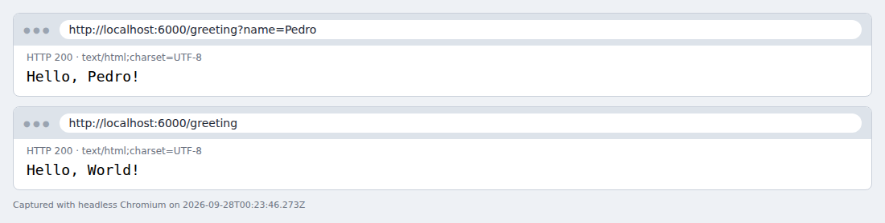
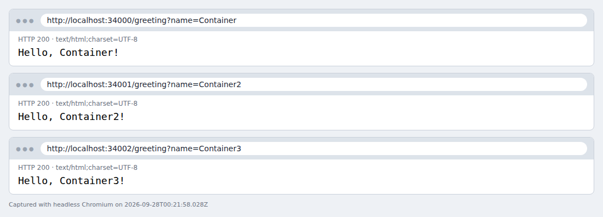
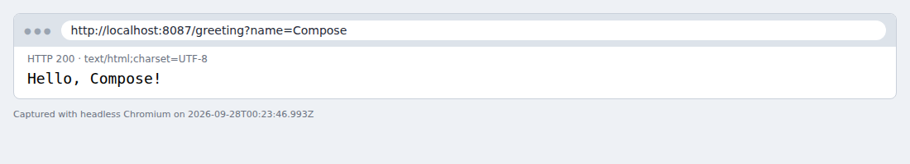
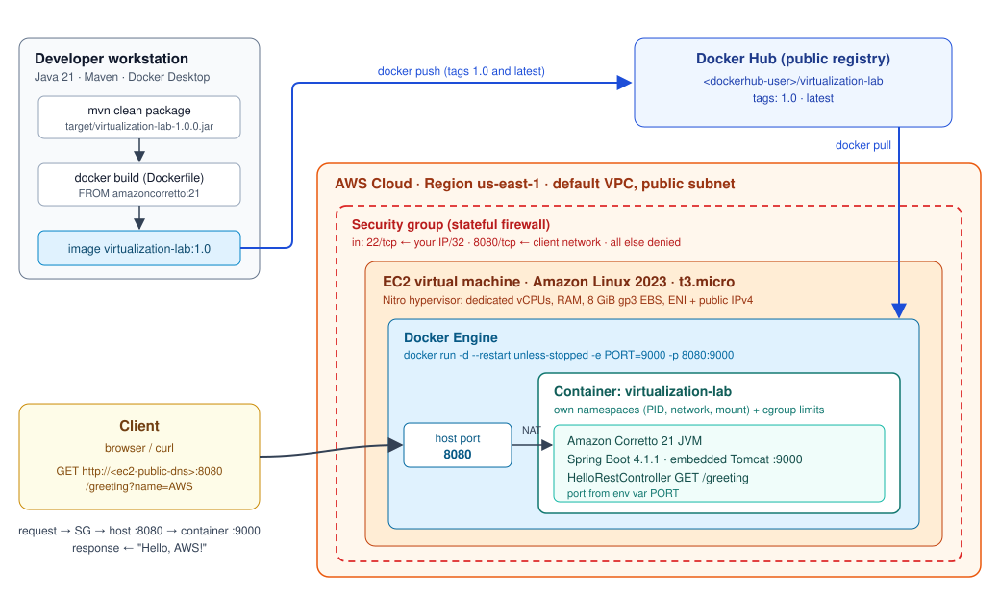

# Containerizing and Deploying a Java Web Application

This workshop uses virtualization to make an application modular, isolated and
portable, and then to deploy it. A small Spring Boot web service is packaged
as a Docker image, run as several isolated containers on one host, combined
with MongoDB through Docker Compose, published to Docker Hub and deployed on an
Amazon EC2 virtual machine. The last part analyses the deployment model and
estimates its monthly cost for three workload levels.

| Deliverable | Link |
|---|---|
| Docker Hub repository | ⏳ TODO: `https://hub.docker.com/r/<dockerhub-user>/virtualization-lab` |
| Public deployment URL (EC2) | ⏳ TODO: `http://<ec2-public-dns>:8080/greeting?name=AWS` |
| Demo video | ⏳ TODO: link to the video |
| Repository 2: framework extension | ⏳ TODO: link to the framework repository |

> Items marked **⏳ TODO** need your own accounts (Docker Hub, AWS) and are
> listed in the [evidence checklist](#10-evidence-checklist). Everything else
> in this README was executed and its output is stored in
> [`docs/evidence`](docs/evidence).

## Contents

1. [Technology baseline](#1-technology-baseline)
2. [Repository structure](#2-repository-structure)
3. [Part 1: Web application](#3-part-1-web-application)
4. [Part 2: Docker image and isolated containers](#4-part-2-docker-image-and-isolated-containers)
5. [Part 3: Multi-container environment with Docker Compose](#5-part-3-multi-container-environment-with-docker-compose)
6. [Part 4: Publishing the image to Docker Hub](#6-part-4-publishing-the-image-to-docker-hub)
7. [Part 5: Deployment on AWS EC2](#7-part-5-deployment-on-aws-ec2)
8. [Part 6: Deployment model](#8-part-6-deployment-model)
9. [Part 6: Cost analysis](#9-part-6-cost-analysis)
10. [Evidence checklist](#10-evidence-checklist)
11. [Assignment extension](#11-assignment-extension)
12. [Cleanup](#12-cleanup)
13. [References](#13-references)

---

## 1. Technology baseline

| Component | Version | Where it is used |
|---|---|---|
| Java | 21 LTS (OpenJDK 21.0.10 on the build host, Amazon Corretto 21.0.12 in the image) | Compile and run |
| Maven | 3.9.11 | Build (`mvn clean package`) |
| Spring Boot | 4.1.1 (embedded Tomcat) | Web framework |
| Docker Engine / Docker Desktop | 29.3.1 with Compose v2 | Images, containers, Compose |
| Base image | `amazoncorretto:21` | Container runtime |
| MongoDB | `mongo:8` (8.3.11 at the time of testing) | Second Compose service |
| Registry | Docker Hub | Image distribution |
| Cloud | AWS EC2, Amazon Linux 2023, us-east-1 | Deployment target |

## 2. Repository structure

```text
.
├── pom.xml                               # Spring Boot 4.1.1 parent, Java 21
├── Dockerfile                            # amazoncorretto:21 runtime image
├── .dockerignore                         # build context = the jar only
├── compose.yaml                          # web + MongoDB, network and volumes
├── src
│   ├── main/java/co/edu/escuelaing/virtualizationlab
│   │   ├── RestServiceApplication.java   # entry point, PORT variable (default 6000)
│   │   └── HelloRestController.java      # GET /greeting?name=...
│   └── test/java/co/edu/escuelaing/virtualizationlab
│       ├── HelloRestControllerTest.java  # MockMvc tests of the endpoint
│       └── RestServiceApplicationTest.java # port resolution tests
├── scripts
│   ├── local-demo.sh                     # build + 3 isolated containers + checks
│   ├── publish-dockerhub.sh              # tag and push 1.0 / latest (optionally multi-arch)
│   ├── ec2-user-data.sh                  # optional EC2 bootstrap for Amazon Linux 2023
│   ├── smoke-test.sh                     # asserts "Hello, <name>!" for any base URL
│   └── LoadTest.java                     # JDK-only load generator used for sizing
└── docs
    ├── diagrams/deployment-model.svg     # deployment-model diagram (PNG copy alongside)
    ├── cost/aws-prices-us-east-1.csv     # unit prices from the AWS Price List API
    ├── cost/estimate.py                  # cost model that produces every number below
    ├── cost/cost-estimate.csv            # line-item output of the cost model
    └── evidence/                         # terminal transcripts and screenshots
```

---

## 3. Part 1: Web application

### Implementation

[`HelloRestController`](src/main/java/co/edu/escuelaing/virtualizationlab/HelloRestController.java)
exposes `GET /greeting` and returns `Hello, <name>!` (`name` defaults to
`World`).

[`RestServiceApplication`](src/main/java/co/edu/escuelaing/virtualizationlab/RestServiceApplication.java)
reads the listening port from the `PORT` environment variable and falls back
to **6000** when it is missing or blank. The value is registered as a Spring
*default property*, so the artifact never changes between environments; only
its configuration does:

| Environment | How the port is set | Port |
|---|---|---|
| Laptop, no configuration | fallback | 6000 |
| Laptop, `PORT=9090` | environment variable | 9090 |
| Container | `ENV PORT=9000` in the Dockerfile, overridable with `-e PORT=...` | 9000 |

> **Note on the workshop text.** The requirement says "use port 6000 by
> default", but the sample `main` method uses `"9000"` as the fallback. This
> implementation follows the requirement (6000) and the verification URL
> `http://localhost:6000/...`; inside the container the Dockerfile sets
> `PORT=9000`, so the container behaviour is identical to the workshop's.

The classes live in the package `co.edu.escuelaing.virtualizationlab`, which
matches the `groupId`. Spring Boot's component scan does not work from the
default package.

### Build and run

```bash
mvn clean package                 # compiles, runs the 5 unit tests, builds the fat jar
java -jar target/*.jar            # listens on 6000
PORT=9090 java -jar target/*.jar  # listens on 9090
```

On Windows PowerShell, `*` is not expanded and variables are set differently:

```powershell
java -jar target\virtualization-lab-1.0.0.jar
$env:PORT = "9090"; java -jar target\virtualization-lab-1.0.0.jar
```

Verify:

```bash
curl "http://localhost:6000/greeting?name=Pedro"
# Hello, Pedro!
```

> **Browsers block port 6000.** Chrome, Edge and Firefox refuse to open
> `http://localhost:6000` (`ERR_UNSAFE_PORT`) because 6000 is the X11 port.
> Use `curl`, Postman, or run with `PORT=8080` to test in a browser. The
> screenshot below was taken with Chromium started with
> `--explicitly-allowed-ports=6000`.

### Evidence



- Build and tests: [`docs/evidence/00-build.txt`](docs/evidence/00-build.txt)
  (`Tests run: 5, Failures: 0`, `BUILD SUCCESS`).
- Local run on the default port 6000 and with `PORT=9090`:
  [`docs/evidence/01-local-run.txt`](docs/evidence/01-local-run.txt).

---

## 4. Part 2: Docker image and isolated containers

### Dockerfile

```dockerfile
FROM amazoncorretto:21
WORKDIR /app
COPY target/*.jar app.jar
ENV PORT=9000
EXPOSE 9000
ENTRYPOINT ["java", "-jar", "app.jar"]
```

| Instruction | Purpose |
|---|---|
| `FROM amazoncorretto:21` | Base layer with Amazon's OpenJDK 21 distribution, the same vendor as the EC2 target. |
| `WORKDIR /app` | Working directory inside the image. |
| `COPY target/*.jar app.jar` | Adds the fat jar built by Maven. Run `mvn clean package` first. |
| `ENV PORT=9000` | Default configuration, read by `RestServiceApplication`. |
| `EXPOSE 9000` | Documents the container port; publishing it is done with `-p`. |
| `ENTRYPOINT [...]` | Exec form: the JVM runs as PID 1 and receives `SIGTERM` directly on `docker stop`. |

[`.dockerignore`](.dockerignore) excludes everything except `target/*.jar`, so
the build context is about 20 MB instead of the whole repository.

### Build, inspect and run

```bash
docker build -t <dockerhub-user>/virtualization-lab:1.0 .
docker images

docker run -d --name virtualization-lab-1 -e PORT=9000 -p 34000:9000 <dockerhub-user>/virtualization-lab:1.0
docker ps
curl "http://localhost:34000/greeting?name=Container"
```

### Container isolation

```bash
docker run -d --name virtualization-lab-2 -p 34001:9000 <dockerhub-user>/virtualization-lab:1.0
docker run -d --name virtualization-lab-3 -p 34002:9000 <dockerhub-user>/virtualization-lab:1.0
curl "http://localhost:34001/greeting?name=Container2"
curl "http://localhost:34002/greeting?name=Container3"
```

`scripts/local-demo.sh` runs all of these steps and checks each response
(`scripts/local-demo.sh --clean` removes the containers).



What the transcript in
[`docs/evidence/03-containers.txt`](docs/evidence/03-containers.txt) shows:

- **Three instances of one image.** The image is built once and runs three
  times, and each container gets its own writable layer.
- **Separate network stacks.** The containers have IP addresses 172.17.0.2,
  172.17.0.3 and 172.17.0.4. All three listen on port 9000 without conflict,
  and each one is reachable through its own host port (34000, 34001, 34002).
- **Separate process trees.** Each JVM logs `PID 1` inside its container,
  while the host sees it as an ordinary process (for example PID 2192).
- **Independent lifecycles.** While `virtualization-lab-2` was stopped, port
  34001 refused connections and 34000 and 34002 kept answering. After
  `docker start`, container 2 answered again.

Image details are in [`docs/evidence/02-docker-image.txt`](docs/evidence/02-docker-image.txt):
771 MB on disk, `PORT=9000`, exposed port `9000/tcp`, entrypoint `java -jar app.jar`.

---

## 5. Part 3: Multi-container environment with Docker Compose

[`compose.yaml`](compose.yaml) defines two services on a shared network:

| Service | Container | Image | Ports | Notes |
|---|---|---|---|---|
| `web` | `virtualization-web` | built from the `Dockerfile` | `8087 → 9000` | `PORT=9000`, `SPRING_DATA_MONGODB_URI=mongodb://db:27017/workshop`, `depends_on: db` |
| `db` | `virtualization-db` | `mongo:8` | `27017 → 27017` | volumes `mongodb:/data/db`, `mongodb_config:/data/configdb` |

The only change from the workshop file is a top-level `name: virtualization-lab`.
It keeps the network and volume names (`virtualization-lab_default`,
`virtualization-lab_mongodb`, …) the same no matter which folder the
repository is cloned into.

```bash
mvn clean package                 # the Dockerfile copies target/*.jar
docker compose up -d --build
docker compose ps
docker compose logs web
docker compose logs db
curl "http://localhost:8087/greeting?name=Compose"

docker compose exec db mongosh
#   show dbs
#   use workshop
#   db.messages.insertOne({ message: "Hello from Docker Compose" })
#   db.messages.find()
#   exit

docker compose down       # removes containers and network, keeps the volumes
docker compose down -v    # also deletes the volumes and the MongoDB data
```



Evidence:

- [`docs/evidence/04-compose.txt`](docs/evidence/04-compose.txt): Compose
  creates the network, both volumes and both containers. `web` resolves the
  hostname `db` to the MongoDB container (`172.18.0.2 db`) through Compose's
  embedded DNS, and the endpoint answers `Hello, Compose!` on port 8087.
- [`docs/evidence/05-mongodb.txt`](docs/evidence/05-mongodb.txt): the mongosh
  session. After `docker compose down` followed by `up`, the document is still
  there (`countDocuments() = 1`). After `docker compose down -v` followed by
  `up`, the data is gone (`0`). The data lives in the volume, not in the
  container.

> The application does not use MongoDB yet, so `SPRING_DATA_MONGODB_URI` has
> no effect until `spring-boot-starter-data-mongodb` is added. Publishing port
> 27017 is useful on a laptop (for MongoDB Compass, for example), but it must
> never be opened in a cloud security group.

---

## 6. Part 4: Publishing the image to Docker Hub

```bash
docker login
docker tag  <dockerhub-user>/virtualization-lab:1.0 <dockerhub-user>/virtualization-lab:latest
docker push <dockerhub-user>/virtualization-lab:1.0
docker push <dockerhub-user>/virtualization-lab:latest
```

Or: `DOCKERHUB_USER=<dockerhub-user> scripts/publish-dockerhub.sh`.

> **Apple Silicon (M1–M4) users:** `docker build` produces an `arm64` image,
> and a t3 instance (x86_64) fails to start it with `exec format error`.
> Publish a multi-architecture image instead:
>
> ```bash
> docker buildx build --platform linux/amd64,linux/arm64 \
>   -t <dockerhub-user>/virtualization-lab:1.0 \
>   -t <dockerhub-user>/virtualization-lab:latest --push .
> ```
>
> (`DOCKERHUB_USER=<dockerhub-user> MULTIARCH=1 scripts/publish-dockerhub.sh`
> does the same.) The Dockerfile has no `RUN` steps, so no emulation is needed.

**Docker Hub repository:** ⏳ TODO: `https://hub.docker.com/r/<dockerhub-user>/virtualization-lab`

**Evidence:** ⏳ TODO: add `docs/evidence/07-dockerhub-tags.png`, a screenshot
of the repository's *Tags* tab showing `1.0` and `latest`.

---

## 7. Part 5: Deployment on AWS EC2

### 7.1 Launch the instance

| Setting | Value |
|---|---|
| Region | us-east-1 (N. Virginia) |
| AMI | Amazon Linux 2023 (x86_64) |
| Instance type | t3.micro (2 vCPU, 1 GiB) |
| Key pair | a new or existing `.pem` key (never commit it; `*.pem` is git-ignored) |
| Storage | 8 GiB gp3 (AMI default) |
| Public IP | auto-assign enabled |
| User data (optional) | [`scripts/ec2-user-data.sh`](scripts/ec2-user-data.sh) installs Docker and starts the container at boot |

### 7.2 Security group

| Direction | Protocol / port | Source | Why |
|---|---|---|---|
| Inbound | TCP 22 (SSH) | *My IP* (`x.x.x.x/32`) | Administration from your machine only |
| Inbound | TCP 8080 | The network that needs access (for a public demo: `0.0.0.0/0`) | The application |
| Outbound | All | `0.0.0.0/0` | `dnf` updates and `docker pull` from Docker Hub |

Do not open 9000 (the container port, reached through the 8080 → 9000 port
mapping), 27017 or any other port.

### 7.3 Install Docker and run the container

```bash
ssh -i <key>.pem ec2-user@<ec2-public-dns>

sudo yum update -y
sudo yum install -y docker
sudo service docker start
sudo usermod -a -G docker ec2-user
exit                                  # log out so the docker group applies

ssh -i <key>.pem ec2-user@<ec2-public-dns>
docker pull <dockerhub-user>/virtualization-lab:1.0
docker run -d \
  --name virtualization-lab \
  --restart unless-stopped \
  -e PORT=9000 \
  -p 8080:9000 \
  <dockerhub-user>/virtualization-lab:1.0

docker ps
docker logs virtualization-lab
```

On Amazon Linux 2023, `yum` is an alias for `dnf`. `sudo systemctl enable docker`
also starts Docker after a reboot, and `--restart unless-stopped` then brings
the container back.

### 7.4 Verify

```bash
curl "http://<ec2-public-dns>:8080/greeting?name=AWS"
# Hello, AWS!
scripts/smoke-test.sh http://<ec2-public-dns>:8080 AWS   # from your machine
```

**Public deployment URL:** ⏳ TODO: `http://<ec2-public-dns>:8080/greeting?name=AWS`

**Evidence:** ⏳ TODO: add to `docs/evidence/`:

- `08-ec2-instance.png`: EC2 console with the running instance (type, AMI, public DNS).
- `09-ec2-security-group.png`: inbound rules.
- `10-ec2-docker.png`: SSH session with `docker ps` and `docker logs virtualization-lab`.
- `11-ec2-browser.png`: browser showing `Hello, AWS!` at the public URL.

> Terminate the instance when you finish (*Instance state → Terminate*).
> Stopping it still bills the EBS volume, and an Elastic IP left behind
> keeps costing USD 0.005/h.

---

## 8. Part 6: Deployment model



```text
Client
  ↓ HTTP request  (GET :8080/greeting)
Security group    (allows 22 from my IP, 8080 from the client network)
  ↓
EC2 virtual machine  (Amazon Linux 2023, t3.micro, Nitro hypervisor)
  ↓
Docker Engine     (port mapping host 8080 → container 9000, restart policy)
  ↓
Java web application container  (Corretto 21 JVM + Spring Boot 4.1.1, :9000)
```

| Layer | Responsibility | Isolation boundary |
|---|---|---|
| **Client** | Sends HTTP requests and renders the response. | None; it is outside AWS. |
| **Security group** | Stateful firewall attached to the instance's network interface. It decides which inbound traffic reaches the VM; anything not allowed is dropped before it reaches the OS. | Network |
| **EC2 virtual machine** | Isolated compute, memory, storage (EBS) and networking (ENI, public IPv4), rented by the hour. The hypervisor isolates it from other tenants on the same physical host. It runs the OS, the Docker Engine and security patches. | Hardware virtualization |
| **Docker Engine** | Pulls images from the registry, creates containers, maps host port 8080 to container port 9000 and restarts the container according to its policy. | Kernel namespaces and cgroups |
| **Container** | Portable runtime environment: the JDK, the jar and the configuration (`PORT`). The same image runs on the laptop and on EC2. | Process, filesystem, network |
| **Java web application** | Receives HTTP requests on Tomcat, routes `/greeting` to the controller and returns the greeting. It holds no state, so any number of copies can serve requests. | JVM |
| **Docker Hub** | Distributes the versioned image (`1.0`, `latest`) from the build machine to the VM. | None |

Two layers of virtualization are stacked. The **VM** virtualizes hardware:
each instance has its own kernel. The **container** virtualizes the operating
system: containers share the VM's kernel but each has its own process tree,
filesystem and network stack. The VM provides strong tenant isolation and a
unit of billing. The container provides packaging, portability and
lightweight isolation between applications that run on the same VM.

---

## 9. Part 6: Cost analysis

### 9.1 Workload assumptions

| Assumption | Small | Medium | Large |
|---|---|---|---|
| Requests per month | 10,000 | 100,000 | 1,000,000 |
| Average rate (730 h/month) | 0.004 req/s | 0.04 req/s | 0.38 req/s |
| Assumed peak (10× average) | 0.04 req/s | 0.4 req/s | 4 req/s |
| AWS Region | us-east-1 (N. Virginia) | us-east-1 | us-east-1 |
| EC2 instance type | t3.micro (2 vCPU, 1 GiB) | t3.small (2 vCPU, 2 GiB) | t3.small (2 vCPU, 2 GiB) |
| Number of instances | 1 | 1 | 2 (one per Availability Zone) |
| Monthly runtime | 730 h (24/7) | 730 h (24/7) | 730 h per instance (24/7) |
| EBS storage | 8 GiB gp3 | 20 GiB gp3 | 20 GiB gp3 per instance |
| Average request / response size | 1 KB / 2 KB | 1 KB / 2 KB | 1 KB / 2 KB |
| Outbound data transfer | ≈ 0.02 GB | ≈ 0.19 GB | ≈ 1.9 GB |
| Public IPv4 addresses | 1 | 1 | 4 (2 instances + 2 ALB nodes) |
| Continuous or scheduled | Continuous; a scheduled variant is shown in 9.4 | Continuous | Continuous |
| High availability | No | No (Docker restart policy + EC2 auto-recovery; minutes of downtime acceptable) | Yes: 2 AZs behind an Application Load Balancer with health checks |

Why these choices:

- **Region.** us-east-1 has the lowest prices and good latency to Colombia.
- **Request and response size.** Measured with `curl`, a request is 96 to 387
  bytes and a response is 127 to 174 bytes, headers included. The model uses
  1 KB and 2 KB to leave room for TCP/TLS overhead and for a richer API later.
- **t3.micro for the small workload.** The container uses about 140 MiB of
  memory ([`06-capacity-test.txt`](docs/evidence/06-capacity-test.txt)), which
  fits in 1 GiB together with Amazon Linux and Docker.
- **t3.small for medium and large.** The reason is memory, not CPU. With
  2 GiB, the old and the new container can run side by side during a
  redeployment, and there is room for a monitoring agent.
- **Two instances for the large workload.** The reason is availability, not
  capacity (see 9.2). A service with a million requests a month is assumed to
  be business-relevant, so losing one AZ or one instance must not take it
  down.
- **Data transfer.** Outbound traffic is billed at USD 0.09/GB. The 100 GB/month
  global free tier would make it USD 0 in every scenario, but it is not
  applied, to be conservative.
- **ALB capacity.** The ALB uses 0.1 LCU on average. At 0.38 req/s, the
  largest LCU dimension (25 new connections/s per LCU) works out to about
  0.016 LCU, so 0.1 is a conservative planning value.

### 9.2 Capacity check (measured)

[`scripts/LoadTest.java`](scripts/LoadTest.java) ran 16 concurrent clients for
30 s, after a 10 s warm-up, against the image with Docker CPU limits that
mimic the *sustained* baseline of burstable instances. A t3.micro may use
10% of each of its 2 vCPUs indefinitely, and a t3.small 20%. Full results are
in [`docs/evidence/06-capacity-test.txt`](docs/evidence/06-capacity-test.txt).

| Limit | Emulates | Throughput | p95 latency | Errors | Memory |
|---|---|---:|---:|---:|---:|
| `--cpus=0.2 --memory=1g` | t3.micro baseline | 341 req/s | 101.5 ms | 0 | 134 MiB |
| `--cpus=0.4 --memory=2g` | t3.small baseline | 2,075 req/s | 76.5 ms | 0 | 143 MiB |
| `--cpus=2` | t3 burst (CPU credits) | 11,733 req/s | 2.6 ms | 0 | 142 MiB |

The large scenario's assumed peak of 4 req/s is about 1% of what a t3.micro
sustains at baseline. CPU never runs above the baseline, so T3 Unlimited
surplus CPU credits (USD 0.05 per vCPU-hour) cost USD 0. This endpoint is
trivial; real business logic or database calls would lower these numbers, but
not by two orders of magnitude.

### 9.3 Unit prices

All prices are On-Demand, Linux, us-east-1. They were extracted from the
official **AWS Price List API** (offer files published between 2026-09-11 and
2026-09-25) and are stored with their source in
[`docs/cost/aws-prices-us-east-1.csv`](docs/cost/aws-prices-us-east-1.csv).

| Item | Price |
|---|---|
| t3.micro / t3.small | USD 0.0104 / 0.0208 per hour |
| EBS gp3 | USD 0.08 per GB-month |
| Public IPv4 address (in use) | USD 0.005 per hour (USD 3.65 per month) |
| Data transfer out to the internet | USD 0.09 per GB (beyond 100 GB/month free) |
| Application Load Balancer | USD 0.0225 per hour + USD 0.008 per LCU-hour |

### 9.4 Cost estimate

Every number below comes from `python3 docs/cost/estimate.py --csv`, which
multiplies the assumptions by the unit prices. The line items are in
[`docs/cost/cost-estimate.csv`](docs/cost/cost-estimate.csv).

| Scenario | Monthly requests | Monthly infrastructure cost | Estimated cost per request | Cost per 1,000 requests | Main cost drivers |
|---|---:|---:|---:|---:|---|
| Small workload | 10,000 | **USD 11.88** | USD 11.88 / 10,000 = **USD 0.00119** | USD 1.19 | EC2 runtime (64%) and public IPv4 (31%) |
| Medium workload | 100,000 | **USD 20.45** | USD 20.45 / 100,000 = **USD 0.00020** | USD 0.20 | EC2 runtime (74%), public IPv4 (18%) and storage (8%) |
| Large workload | 1,000,000 | **USD 65.35** | USD 65.35 / 1,000,000 = **USD 0.000065** | USD 0.065 | Instance count for HA (46%), load balancer (26%) and public IPv4 (22%) |

`Estimated cost per request = monthly infrastructure cost / monthly requests`

Line items (USD per month):

| Item | Small | Medium | Large |
|---|---:|---:|---:|
| EC2 compute | 7.59 (1 × t3.micro × 730 h) | 15.18 (1 × t3.small × 730 h) | 30.37 (2 × t3.small × 730 h) |
| EBS gp3 | 0.64 (8 GB) | 1.60 (20 GB) | 3.20 (2 × 20 GB) |
| Data transfer out | 0.002 (0.02 GB) | 0.02 (0.19 GB) | 0.17 (1.9 GB) |
| Public IPv4 | 3.65 (1 address) | 3.65 (1 address) | 14.60 (4 addresses) |
| Application Load Balancer | n/a | n/a | 17.01 |
| **Total** | **11.88** | **20.45** | **65.35** |

Sensitivity:

| Variant | Monthly cost | Cost per request | Difference |
|---|---:|---:|---|
| Small, scheduled for office hours only (12 h × 22 days = 264 h) | USD 4.71 | USD 0.00047 | −60%. EBS is still billed while the instance is stopped; the auto-assigned public IP is not. |
| Large, single t3.small without HA | USD 20.61 | USD 0.000021 | −68%. This is the price of high availability. |
| Any scenario, outbound traffic within the 100 GB/month free tier | −USD 0.002 to −0.17 | — | Negligible |

Data transfer is below 1% of the cost in every scenario. It would only matter
for much larger responses: for the large scenario, outbound traffic would cost
as much as the two instances (USD 30) at about 350 KB per response.

### 9.5 AWS Pricing Calculator

The estimate is designed to be entered as-is in the
[AWS Pricing Calculator](https://calculator.aws/). The calculator could not be
reached from the environment where this analysis was prepared, so the export
still has to be generated from a browser:

1. *Create estimate → Add service → Amazon EC2*. Region **US East (N. Virginia)**,
   *Linux*, *Shared* tenancy, workload **Constant usage**, pricing
   **On-Demand**, utilization **100% (730 h/month)**.
2. Instance and storage: small `1 × t3.micro` + `8 GB gp3`; medium
   `1 × t3.small` + `20 GB gp3`; large `2 × t3.small` + `20 GB gp3` each.
   Keep the gp3 baseline of 3000 IOPS and 125 MB/s.
3. *Data transfer → Outbound → Internet*: 0.02 / 0.19 / 1.9 GB per month.
4. *Amazon VPC → Public IPv4 addresses*: 1 / 1 / 4 in-use addresses, 730 h.
5. Large only: *Elastic Load Balancing → Application Load Balancer*, 1 ALB,
   about 3 GB processed per month and 2.5 new connections/s on average
   (= 0.1 LCU, the conservative planning value).
6. Put each scenario in its own group, then choose *Export → PDF* and *CSV*.

**Evidence:** ⏳ TODO: add `docs/cost/aws-pricing-calculator-estimate.pdf`
(or `.csv`, or a screenshot) and the public share link:
`https://calculator.aws/#/estimate?id=...`. The totals should match the table
above to within cents; the calculator may show USD 0 for data transfer if it
applies the free tier.

### 9.6 Architectural discussion

**1. Why does an EC2-based deployment have a baseline monthly cost even when
the application receives few requests?**

EC2 bills for provisioned capacity, not for work done. From the moment the
instance is running you pay for its vCPUs and RAM every hour, whether it
serves zero requests or a thousand. The EBS volume is billed per GB-month
even while the instance is stopped, and the public IPv4 address is billed per
hour. In the small scenario the application is busy for roughly
10,000 × 50 ms ≈ 8 minutes a month. The other 99.98% of the time the instance
is idle, and USD 11.88 is still due. That cost is fixed by the architecture,
not by the traffic.

**2. At which workload level does the fixed cost become less significant per
request?**

The cost is almost entirely fixed: the only variable item, data transfer,
costs USD 0.00000017 per request. The fixed cost is spread over more
requests as volume grows, so the cost per request falls tenfold for each
tenfold increase in traffic, from USD 1.19 to 0.20 to 0.065 (and 0.021 without
HA) per 1,000 requests. The fixed cost becomes insignificant per request
between the medium and the large workload. From about 200,000 requests a
month, a single t3.small costs less than USD 0.0001 per request, and at 1
million requests it costs USD 0.00002. It would take about 119 million
requests a month (45 req/s on average) for variable costs to equal the fixed
cost of one t3.small, and the capacity test shows that one instance can still
handle that rate. In short, EC2 becomes efficient per request when a
reasonably busy, steady workload keeps the fixed capacity in use.

**3. What would force you to move from one EC2 instance to multiple
instances?**

- **Availability.** In these scenarios this is the real reason. One instance
  is one AZ and one OS: a hardware failure, an AZ event, a kernel patch or a
  redeployment all mean downtime. An uptime SLA (for example 99.9%, about 43
  minutes of downtime a month) needs at least two instances in different AZs
  behind a load balancer.
- **Sustained CPU above the burst baseline.** When average CPU stays above
  10–20%, T3 credits run out (or cost extra in Unlimited mode) and latency
  grows. The measured limits are about 340 req/s (t3.micro) and 2,000 req/s
  (t3.small) for this endpoint. Beyond that the choice is between a larger
  instance and more instances.
- **Memory.** The JVM heap, caches or more services per host may no longer fit.
- **Latency SLOs at peak.** Traffic spikes that one node cannot absorb need
  horizontal scaling with an Auto Scaling group.
- **Operational needs.** Rolling or blue/green deployments without downtime,
  and a smaller blast radius.

The service is stateless, so it scales horizontally without code changes.
Once it persists data, the database has to scale and replicate separately.

**4. Which additional services would a production deployment likely require?**

| Need | Service | Why |
|---|---|---|
| Traffic distribution and TLS | Application Load Balancer + AWS Certificate Manager | HTTPS, health checks, several AZs (from USD 16.43/month plus LCUs) |
| Elasticity and self-healing | EC2 Auto Scaling group + launch template | Replace unhealthy instances, scale on CPU or request count |
| DNS | Amazon Route 53 | A stable name instead of the EC2 public DNS |
| Container registry | Amazon ECR (USD 0.10/GB-month) | Private images next to the compute, IAM-based pulls, vulnerability scanning, no Docker Hub pull rate limits |
| Database | Amazon DocumentDB or MongoDB Atlas instead of the `mongo` container | Replication, automated backups, patching |
| Observability | Amazon CloudWatch (logs, metrics, alarms), optionally X-Ray | Know when the service fails before users report it |
| Backups | AWS Backup / EBS snapshots | Recovery point for data and configuration |
| Secure administration | AWS Systems Manager Session Manager | Remove SSH port 22 from the security group |
| Secrets and configuration | AWS Secrets Manager / Parameter Store | Database credentials outside the image |
| Edge protection | AWS WAF, AWS Shield Standard | Filter malicious traffic |
| Delivery | CI/CD pipeline (for example GitHub Actions → ECR → rolling deploy) | Repeatable builds and deployments |
| Orchestration (optional) | Amazon ECS on EC2 or on Fargate | Manages container placement and rolling updates, in place of `docker run` on a hand-built VM |

**5. Would a serverless deployment be more cost-effective for the small
workload?**

Yes. The small workload is sparse and intermittent: about 333 requests a day,
one every 4.4 minutes on average, each lasting milliseconds. The instance is
idle more than 99.9% of the time. Pay-per-request pricing matches that shape,
and pay-per-hour pricing does not. With API Gateway (HTTP API) and AWS Lambda
at 1 GB of memory, assuming half of the requests pay a cold start of about
3 s (1.5 s billed on average):

| | Small (10,000 req) | Medium (100,000 req) | Large (1,000,000 req) |
|---|---:|---:|---:|
| EC2 as designed | USD 11.88 | USD 20.45 | USD 65.35 |
| API Gateway + Lambda (+ ECR storage) | USD 0.29 | USD 0.33 | USD 3.07 |

With the Lambda free tier (1 million requests and 400,000 GB-seconds per
month) the small scenario would cost practically nothing. For warm
invocations the serverless cost is about USD 0.003 per 1,000 requests, so it
only matches the small EC2 instance at about **3.9 million requests a month**
of steady traffic. All three scenarios are below that point.

The workload characteristics also bring trade-offs that must be accepted:

- **Cold starts.** With traffic this sparse, many requests find no warm
  environment, and a Spring Boot JVM takes seconds to start. That is a
  visible latency penalty unless you use Lambda SnapStart, or provisioned
  concurrency, which brings back a fixed hourly cost.
- **Packaging changes.** The app needs a Lambda adapter (for example
  `aws-serverless-java-container` or the Lambda Web Adapter), and container
  images must come from ECR, not Docker Hub.
- **Limits.** API Gateway has a 29–30 s request timeout, Lambda runs for at
  most 15 minutes, and there are no long-lived connections or in-memory state
  between requests.

The conclusion comes from the traffic shape (low volume, bursty, long idle
periods), not from technology trends. A steady workload of several million
requests a month, or one that needs constant low latency, would favour
containers on EC2 or Fargate.

### 9.7 Conclusion

EC2 is **technically appropriate** for this workload. The same image that ran
on the laptop runs unchanged on the VM, the deployment is simple and fully
under your control, and a single t3.micro has two orders of magnitude of
spare capacity. For the small workload, however, it is **not the most
cost-effective choice**. USD 11.88 a month is almost all idle capacity, a
third of it is the public IPv4 address, and the cost per request (USD 0.0012)
is about 40 times that of a serverless deployment.

- **Small:** EC2 is appropriate for the workshop and for learning. To save
  money, run it only during office hours (USD 4.71) or move to Lambda.
- **Medium:** a single t3.small at USD 20.45 is reasonable when you need a
  long-running container, but serverless would still be cheaper.
- **Large:** high availability dominates the cost (USD 20.61 → 65.35). EC2
  with an ALB is justified once traffic is steady and several million
  requests a month (or latency requirements that cold starts cannot meet)
  make the fixed capacity pay off. Savings Plans or Reserved Instances would
  lower the compute line further.

For this workshop, the selected deployment (one t3.micro running one
container, terminated after the demo) is the right choice: it teaches the
full VM + container stack for about USD 0.40 per day.

---

## 10. Evidence checklist

| Required evidence | Status | Location |
|---|---|---|
| Complete source code | ✅ | [`src/`](src) |
| Dockerfile and compose.yaml | ✅ | [`Dockerfile`](Dockerfile), [`compose.yaml`](compose.yaml) |
| Build, execution, containerization and deployment instructions | ✅ | Sections 3–7 |
| Local execution | ✅ | [`00-build.txt`](docs/evidence/00-build.txt), [`01-local-run.txt`](docs/evidence/01-local-run.txt), [`01-local-run.png`](docs/evidence/01-local-run.png) |
| Built image and running containers | ✅ | [`02-docker-image.txt`](docs/evidence/02-docker-image.txt), [`03-containers.txt`](docs/evidence/03-containers.txt), [`03-containers.png`](docs/evidence/03-containers.png) |
| Docker Compose with MongoDB | ✅ | [`04-compose.txt`](docs/evidence/04-compose.txt), [`04-compose.png`](docs/evidence/04-compose.png), [`05-mongodb.txt`](docs/evidence/05-mongodb.txt) |
| Capacity measurement | ✅ | [`06-capacity-test.txt`](docs/evidence/06-capacity-test.txt) |
| Deployment-model diagram | ✅ | [`docs/diagrams/deployment-model.svg`](docs/diagrams/deployment-model.svg) |
| Cost-analysis table and assumptions | ✅ | Section 9, [`docs/cost/`](docs/cost) |
| Docker Hub repository URL and image evidence | ⏳ TODO | Section 6, `docs/evidence/07-dockerhub-tags.png` |
| Successful EC2 deployment and public URL | ⏳ TODO | Section 7, `docs/evidence/08-…11-*.png` |
| AWS Pricing Calculator export | ⏳ TODO | Section 9.5, `docs/cost/aws-pricing-calculator-estimate.pdf` |
| Demonstration video | ⏳ TODO | Link at the top of this README |

The local evidence was captured on a Linux host with Docker Engine 29.3.1.
The screenshots were taken with headless Chromium, and each one shows the URL
and the HTTP status of the response. Terminal transcripts are unedited
excerpts of the command output.

Suggested outline for the video (about 5 minutes): `mvn clean package` →
`scripts/local-demo.sh` (three containers answering on 34000–34002) →
`docker compose up -d --build` with the mongosh session → the Docker Hub tags
page → SSH into EC2 with `docker ps` → the public URL in a browser → the cost
table.

## 11. Assignment extension

The extension (your own framework, without Spring, with concurrent request
handling, graceful shutdown, a port read from an environment variable, Docker
and EC2) goes in the second repository:

⏳ TODO: link to Repository 2 and the commit that introduces the extension.

## 12. Cleanup

```bash
scripts/local-demo.sh --clean                       # the three isolated containers
docker compose down -v                              # Compose containers, network and volumes
docker rmi <dockerhub-user>/virtualization-lab:1.0  # local image
# AWS: terminate the instance and release any Elastic IP address
```

## 13. References

- Spring Boot documentation: https://docs.spring.io/spring-boot/
- Amazon Corretto Docker images: https://docs.aws.amazon.com/corretto/latest/corretto-21-ug/docker-install.html
- MongoDB official Docker image: https://hub.docker.com/_/mongo
- Docker Compose file reference: https://docs.docker.com/reference/compose-file/
- Amazon EC2 security groups: https://docs.aws.amazon.com/AWSEC2/latest/UserGuide/ec2-security-groups.html
- Burstable performance instances (T3 baseline and credits): https://docs.aws.amazon.com/ec2/latest/instancetypes/burstable-performance-instances.html
- AWS Price List bulk API: https://docs.aws.amazon.com/awsaccountbilling/latest/aboutv2/using-ppslong.html
- AWS Pricing Calculator: https://docs.aws.amazon.com/pricing-calculator/latest/userguide/
